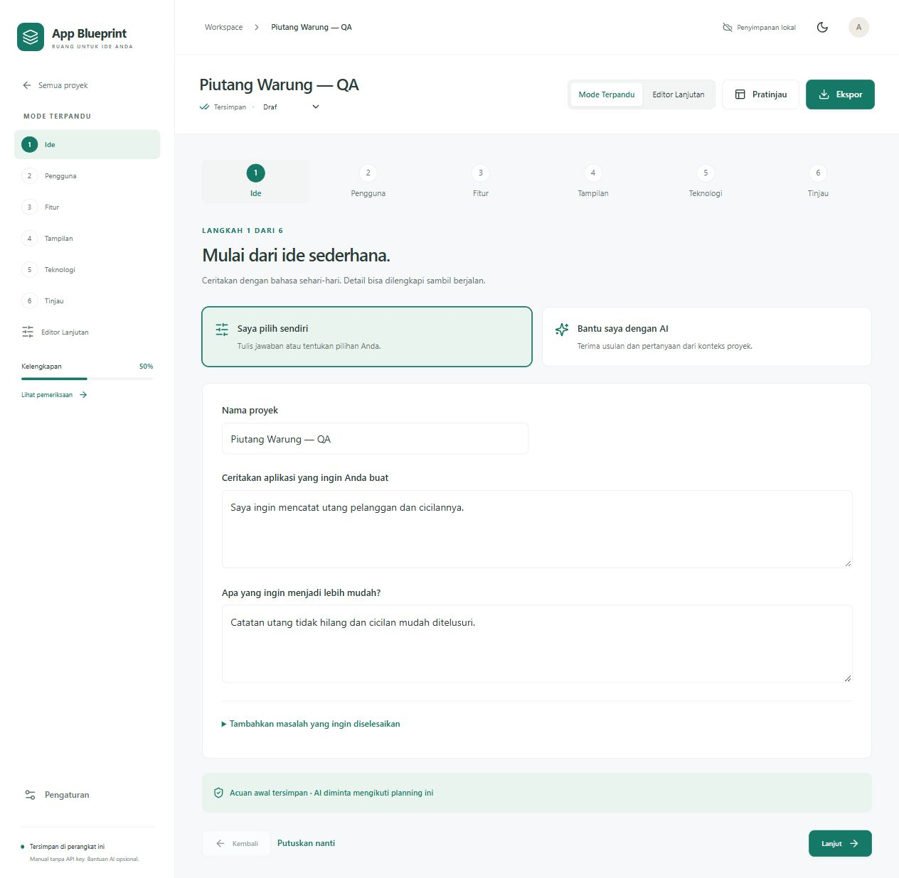

# App Blueprint

Ruang kerja pribadi berbahasa Indonesia untuk mengubah ide aplikasi menjadi spesifikasi yang dapat dilampirkan ke Codex atau AI pembuat aplikasi lainnya.



## Menjalankan

Gunakan Node.js **22.12+** (atau 24 LTS) dan **pnpm 11.25.0**.

```sh
git clone https://github.com/andikapramudyadika/App-Blueprint.git
cd App-Blueprint
pnpm install --frozen-lockfile
pnpm dev
```

Buka alamat lokal yang dicetak Vite.

```sh
pnpm typecheck
pnpm test
pnpm build
pnpm preview
```

Build produksi berada di `dist/`. Aplikasi dapat ditempatkan pada hosting statis HTTPS; `base: './'` mendukung subfolder. Untuk pengembangan lokal, HTTP localhost juga mendukung service worker. Mode offline PWA tersedia pada **build produksi**, setelah service worker dan aset selesai disimpan.

## Mengakses melalui GitHub Pages

Alamat aplikasi: **https://andikapramudyadika.github.io/App-Blueprint/**.

Pada **Settings → Pages → Build and deployment → Source**, gunakan **GitHub Actions**. Workflow `Deploy GitHub Pages` membangun aplikasi menggunakan `pnpm build --base=/App-Blueprint/`, memeriksa aset, kemudian menerbitkan **isi folder `dist`**. Push ke `main` memicu pembaruan; deployment juga dapat dijalankan manual melalui tab Actions.

Jangan menerbitkan root kode sumber menggunakan “Deploy from a branch”: `index.html` pada root adalah entry point pengembangan yang memerlukan Vite, sehingga bukan berkas yang bisa langsung dijalankan oleh GitHub Pages. Panduan: [deployment Vite ke GitHub Pages](https://vite.dev/guide/static-deploy#github-pages).

Data proyek tetap berada di browser perangkat yang sedang dipakai. Untuk memindahkan data dari localhost ke situs Pages atau ke perangkat lain, gunakan backup/impor JSON.

## Fitur

- Mode Terpandu dengan enam langkah: Ide, Pengguna, Fitur, Tampilan, Teknologi, dan Tinjau. Pilih pengisian manual atau bantuan AI pada tiap tahap; Editor Lanjutan dengan sepuluh bagian tetap tersedia dan memakai data proyek yang sama.
- OpenRouter opsional: usulan perbaikan, fitur, dan maksimal tiga pertanyaan lanjutan berdasarkan konteks sebelumnya. Tinjau nilai lama/usulan dan pilih perubahan sebelum menerapkannya sebagai draf. Acuan awal membantu menjaga arah; perubahan yang menyentuh acuan meminta tinjauan tambahan. Tersedia pembatalan penerapan terakhir selama belum ada edit lain.
- Dashboard dengan pencarian, filter status, pengurutan, duplikasi, dan konfirmasi penghapusan dengan nama proyek.
- Sepuluh bagian penyusunan: ringkasan, fitur, alur pengguna, layar, desain, motion, data, rencana implementasi, kriteria penerimaan, serta keputusan dan pertanyaan.
- Semua fitur memiliki ID stabil. Dependensi dapat dipilih, tidak dapat mengacu pada diri sendiri melalui editor, dan referensi yang terhapus ditandai. Pengurutan menggunakan tombol naik/turun yang dapat dioperasikan dengan keyboard.
- Entitas data memiliki editor field untuk nama, tipe, wajib/opsional, nilai awal, relasi, dan validasi.
- Status manual per bagian dan status dokumen terpisah dari perhitungan kelengkapan. Checklist penerimaan hanya berubah melalui tindakan pengguna.
- Preset desain dengan konfirmasi sebelum menimpa isian, serta pratinjau kartu, tombol, input, dan badge. Nilai style dibatasi pada warna hex dan angka dalam rentang aman.
- Aturan motion yang dapat diedit dan lab interaktif untuk tombol, modal, tab, kartu, dan notifikasi. Reduced motion mengikuti preferensi sistem. Contoh lab memakai efek terbatas; aturan efek/easing lainnya tetap disimpan dan diekspor sebagai spesifikasi.
- Autosave debounce 500 ms di IndexedDB melalui Dexie, dengan antrean penulisan berurutan. Perpindahan proyek menunggu penyimpanan; bila gagal, isian tetap berada di editor dan dapat diekspor. Perpindahan bagian dan ekspor menangani perubahan tertunda.
- Pemeriksa lokal dengan 10 aturan. Persentase adalah aturan terpenuhi / 10, bukan skor kualitas. Saran kata “modern”/“smooth” merupakan heuristik dan tidak mengubah persentase.
- Ekspor langsung Markdown, ZIP, backup satu proyek atau semua proyek. Generator prompt untuk MVP atau tahap yang dipilih, dengan salin dan unduh.
- Impor JSON tervalidasi Zod, ringkasan sebelum diterapkan, salinan baru secara default, penggantian ID yang sama hanya setelah pilihan dan konfirmasi eksplisit. Penulisan batch dalam transaksi.
- Contoh Quiet Focus hanya ditambahkan setelah dipilih pengguna.
- Mode terang/gelap, layout responsif, dialog native dengan pengelolaan fokus, navigasi ponsel dengan Escape dan perangkap fokus, serta fokus keyboard yang terlihat.
- Manifest, ikon PNG/SVG lokal, cache aset, dan pemberitahuan pembaruan PWA. Pembaruan tidak memuat ulang editor secara paksa.

## Paket ekspor

ZIP berisi `README.md`, `APP_SPEC.md`, `PRD.md`, `UI_SPEC.md`, `MOTION_SPEC.md`, `DATA_MODEL.md`, `IMPLEMENTATION_PLAN.md`, `ACCEPTANCE_CRITERIA.md`, dan `PROJECT_BACKUP.json`.

Semua dokumen berasal dari data proyek yang sama. Isian kosong ditulis **Belum ditentukan**. Isian pengguna ditempatkan di blok teks literal dengan panjang pagar dinamis agar karakter Markdown, HTML, tabel, dan code fence tetap utuh tanpa mengubah struktur dokumen. Pratinjau memakai React Markdown + GFM tanpa raw HTML. File `AGENTS.md` tidak dihasilkan.

## Penyimpanan & batasan

- Tidak ada backend, login aplikasi, atau sinkronisasi cloud. Mode manual bekerja tanpa API key. GitHub menyimpan kode aplikasi, bukan data proyek pengguna. Bantuan AI mengirim konteks yang disetujui pengguna langsung dari browser ke OpenRouter dan provider model.
- Data terikat pada browser, profil, perangkat, dan origin (termasuk port) yang dipakai. Mengganti alamat atau browser tidak memindahkan data; gunakan backup JSON.
- Menghapus data situs, menonaktifkan penyimpanan, kuota penuh, atau browser menghapus storage dapat menghilangkan data. Cadangkan secara berkala. Aplikasi memberi pesan kegagalan penyimpanan, tetapi bukan layanan backup otomatis.
- Tidak ada penggabungan konflik antar-tab. Hindari mengedit proyek yang sama di beberapa tab sekaligus.
- Ada versi dokumen dan ringkasan perubahan manual, tanpa riwayat versi penuh.
- Impor mendukung schemaVersion 1, maksimal 20 MB dan 500 proyek per backup. Tidak ada migrasi untuk versi skema yang belum dikenal.
- Penghapusan proyek permanen dari browser setelah konfirmasi. Backup yang sudah diunduh tidak ikut dihapus.
- Instalasi PWA tergantung browser. Aplikasi tetap bekerja sebagai web biasa. Tidak ada klaim status “terpasang” otomatis.

## Menggunakan bantuan AI

1. Buka **Pengaturan & pencadangan**, atau pilih **Bantu saya dengan AI → Hubungkan OpenRouter** pada Mode Terpandu.
2. Buat key khusus dengan batas belanja pada [pengaturan OpenRouter](https://openrouter.ai/settings/keys), masukkan key, lalu pilih **Hubungkan untuk sesi ini**. Key berada hanya di memori tab: tidak ditulis ke localStorage, sessionStorage, IndexedDB, backup, ekspor, URL, atau log aplikasi. Reload, menutup halaman, atau **Putuskan koneksi** menghapus koneksi.
3. Pilih model. Pilihan awal DeepSeek V4 Flash 0731; tersedia Gemini 2.5 Flash Lite, Gemini 3.8 Flash, atau ID model lain yang mendukung Structured Outputs. Ketersediaan dan harga mengikuti OpenRouter.
4. Isi ide singkat, simpan acuan awal pada tahap Pengguna, lalu tinjau konteks dan centang persetujuan pengiriman sebelum meminta AI. Tidak ada panggilan per ketikan atau percobaan ulang otomatis.
5. Pilih usulan yang sesuai dan terapkan sebagai draf. Jawab pertanyaan lanjutan dengan opsi atau teks singkat; gunakan tombol penerapan jawaban untuk mengisi field terkait. Checklist penerimaan dan status Disepakati tetap merupakan keputusan pengguna.

Provider yang mengumpulkan data untuk pelatihan dikecualikan. **Zero Data Retention** aktif secara default; model tanpa provider yang cocok akan gagal dengan pesan, sehingga pengguna perlu memilih model yang sesuai atau meninjau opsi tersebut. Lihat [kebijakan data provider](https://openrouter.ai/docs/guides/privacy/provider-logging) dan [Structured Outputs](https://openrouter.ai/docs/guides/features/structured-outputs).

Konteks dibatasi pada bagian terkait, 12 item per daftar dan 1.600 karakter per field; pratinjau memperlihatkan konteks yang dikirim. Batas respons awal 16.384 token (termasuk penalaran AI) dan waktu tunggu 180 detik. **Batas token respons** di Pengaturan koneksi dapat dipilih dari 4.096 hingga 32.768 token. Batas lebih besar dapat menambah biaya dan waktu tunggu. Jika respons terpotong, aplikasi menampilkan langkah pemulihan dan penggunaan token/biaya yang dilaporkan provider tetap tersedia di pengaturan; kirim ulang hanya setelah menyesuaikan batas, memperkecil permintaan, atau mengganti model. Tidak ada percobaan ulang otomatis. Respons terpotong, salah format, atau respons lama setelah edit tidak diterapkan. Pembatalan menghentikan penantian browser, tetapi permintaan yang sudah diproses provider bisa tetap berbiaya. AI memerlukan internet dan kredit OpenRouter. Lihat [penjelasan OpenRouter tentang token penalaran dan batas keluaran](https://openrouter.ai/docs/guides/best-practices/reasoning-tokens).

Repositori publik tidak berisi key pengguna. Penyimpanan di memori mengurangi paparan, tetapi skrip berbahaya atau ekstensi yang menguasai halaman tetap bisa membaca kredensial saat dipakai. Gunakan key terbatas dan jangan masukkan rahasia ke isian proyek. Jawaban panduan, acuan, serta pertanyaan AI ikut dalam backup dan dokumen proyek; kredensial tidak ikut.

## Struktur kode

```text
src/model.ts          Skema, definisi field, preset, contoh, dan duplikasi
src/storage.ts        IndexedDB, transaksi impor, dan antrean autosave
src/useProject.ts     State editor, debounce, flush, dan status penyimpanan
src/checks.ts         Pemeriksaan kelengkapan berbasis aturan
src/documents.ts      Generator Markdown, ZIP, JSON, dan prompt implementasi
src/components.tsx    Formulir, daftar, dialog, dan pratinjau desain/motion
src/App.tsx           Dashboard, workspace, pengaturan, impor, ekspor
src/GuidedWizard.tsx  Enam tahap manual/AI, tinjauan usulan, tanya jawab
src/guided.ts         Konteks terbatas, validasi dan penerapan usulan
src/guided-schema.ts  Metadata panduan opsional, kompatibel backup lama
src/openrouter.ts     Koneksi sesi dalam memori dan transport OpenRouter
src/AiSettings.tsx    Pengaturan koneksi, model, dan preferensi provider
src/guided.test.ts    Pengujian panduan, keamanan data, transport tiruan
src/styles.css        Tema, layout responsif, fokus, dan reduced motion
src/core.test.ts      Pengujian data, generator, validasi, dan penyimpanan
```

Hasil verifikasi dan skenario pemeriksaan browser dicatat di [VERIFICATION.md](VERIFICATION.md).

## Referensi implementasi

[Vite](https://vite.dev/guide/), [Dexie](https://dexie.org/docs/Tutorial/React), [Vite PWA](https://vite-pwa-org.netlify.app/guide/auto-update), dan [konfigurasi pnpm 11](https://pnpm.io/blog/releases/11.0).
