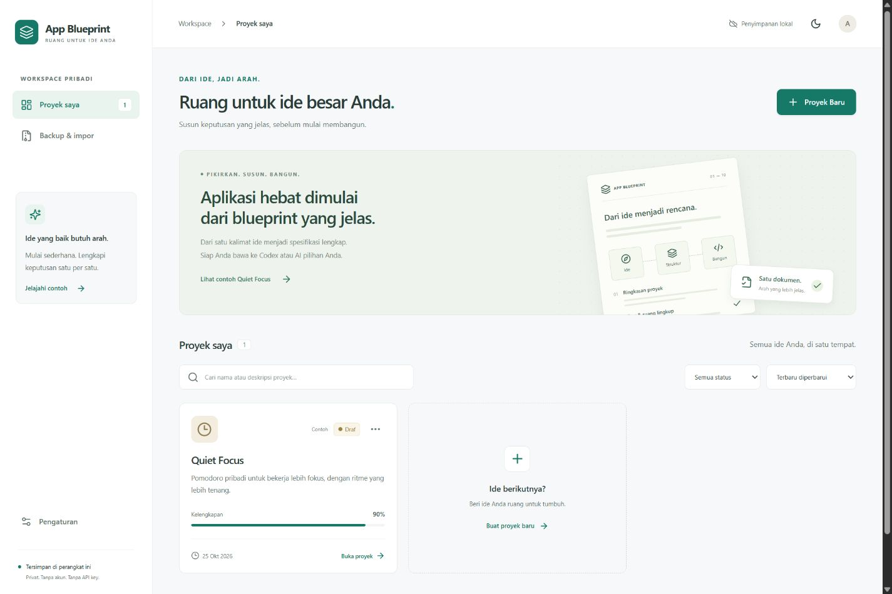

# App Blueprint

Ruang kerja pribadi berbahasa Indonesia untuk mengubah ide aplikasi menjadi spesifikasi yang dapat dilampirkan ke Codex atau AI pembuat aplikasi lainnya.



## Menjalankan

Gunakan Node.js **22.12+** (atau 24 LTS) dan **pnpm 11.25.0**.

```sh
git clone https://github.com/andikapramudyadika/App-Blueprint.git
cd App-Blueprint
pnpm install --frozen-lockfile
pnpm dev
```

Buka alamat lokal yang dicetak Vite. Akses repositori memerlukan akun GitHub pemilik atau kolaborator karena repositori bersifat privat.

```sh
pnpm typecheck
pnpm test
pnpm build
pnpm preview
```

Build produksi berada di `dist/`. Aplikasi dapat ditempatkan pada hosting statis HTTPS; `base: './'` mendukung subfolder. Untuk pengembangan lokal, HTTP localhost juga mendukung service worker. Mode offline PWA tersedia pada **build produksi**, setelah service worker dan aset selesai disimpan.

## Fitur

- Dashboard dengan pencarian, filter status, pengurutan, duplikasi, dan konfirmasi penghapusan dengan nama proyek.
- Sepuluh bagian penyusunan: ringkasan, fitur, alur pengguna, layar, desain, motion, data, rencana implementasi, kriteria penerimaan, serta keputusan dan pertanyaan.
- Semua fitur memiliki ID stabil. Dependensi dapat dipilih, tidak dapat mengacu pada diri sendiri melalui editor, dan referensi yang terhapus ditandai. Pengurutan menggunakan tombol naik/turun yang dapat dioperasikan dengan keyboard.
- Entitas data memiliki editor field untuk nama, tipe, wajib/opsional, nilai awal, relasi, dan validasi.
- Status manual per bagian dan status dokumen terpisah dari perhitungan kelengkapan. Checklist penerimaan hanya berubah melalui tindakan pengguna.
- Preset desain dengan konfirmasi sebelum menimpa isian, serta pratinjau kartu, tombol, input, dan badge. Nilai style dibatasi pada warna hex dan angka dalam rentang aman.
- Aturan motion yang dapat diedit dan lab interaktif untuk tombol, modal, tab, kartu, dan notifikasi. Reduced motion mengikuti preferensi sistem. Contoh lab memakai efek terbatas; aturan efek/easing lainnya tetap disimpan dan diekspor sebagai spesifikasi.
- Autosave debounce 500 ms di IndexedDB melalui Dexie, dengan antrean penulisan berurutan. Perpindahan proyek menunggu penyimpanan; bila gagal, isian tetap berada di editor dan dapat diekspor. Perpindahan bagian dan ekspor menangani perubahan tertunda.
- Pemeriksa lokal dengan 10 aturan. Persentase adalah aturan terpenuhi / 10, bukan skor kualitas. Saran kata “modern”/“smooth” merupakan heuristik dan tidak mengubah persentase.
- Ekspor langsung Markdown, ZIP, backup satu proyek atau semua proyek. Generator prompt untuk MVP atau tahap yang dipilih, dengan salin dan unduh.
- Impor JSON tervalidasi Zod, ringkasan sebelum diterapkan, salinan baru secara default, penggantian ID yang sama hanya setelah pilihan dan konfirmasi eksplisit. Penulisan batch dalam transaksi.
- Contoh Quiet Focus hanya ditambahkan setelah dipilih pengguna.
- Mode terang/gelap, layout responsif, dialog native dengan pengelolaan fokus, navigasi ponsel dengan Escape dan perangkap fokus, serta fokus keyboard yang terlihat.
- Manifest, ikon PNG/SVG lokal, cache aset, dan pemberitahuan pembaruan PWA. Pembaruan tidak memuat ulang editor secara paksa.

## Paket ekspor

ZIP berisi `README.md`, `APP_SPEC.md`, `PRD.md`, `UI_SPEC.md`, `MOTION_SPEC.md`, `DATA_MODEL.md`, `IMPLEMENTATION_PLAN.md`, `ACCEPTANCE_CRITERIA.md`, dan `PROJECT_BACKUP.json`.

Semua dokumen berasal dari data proyek yang sama. Isian kosong ditulis **Belum ditentukan**. Isian pengguna ditempatkan di blok teks literal dengan panjang pagar dinamis agar karakter Markdown, HTML, tabel, dan code fence tetap utuh tanpa mengubah struktur dokumen. Pratinjau memakai React Markdown + GFM tanpa raw HTML. File `AGENTS.md` tidak dihasilkan.

## Penyimpanan & batasan

- Tidak ada backend, login aplikasi, pembayaran, API AI, atau sinkronisasi cloud. GitHub digunakan untuk menyimpan kode aplikasi, bukan data proyek pengguna.
- Data terikat pada browser, profil, perangkat, dan origin (termasuk port) yang dipakai. Mengganti alamat atau browser tidak memindahkan data; gunakan backup JSON.
- Menghapus data situs, menonaktifkan penyimpanan, kuota penuh, atau browser menghapus storage dapat menghilangkan data. Cadangkan secara berkala. Aplikasi memberi pesan kegagalan penyimpanan, tetapi bukan layanan backup otomatis.
- Tidak ada penggabungan konflik antar-tab. Hindari mengedit proyek yang sama di beberapa tab sekaligus.
- Ada versi dokumen dan ringkasan perubahan manual, tanpa riwayat versi penuh.
- Impor mendukung schemaVersion 1, maksimal 20 MB dan 500 proyek per backup. Tidak ada migrasi untuk versi skema yang belum dikenal.
- Penghapusan proyek permanen dari browser setelah konfirmasi. Backup yang sudah diunduh tidak ikut dihapus.
- Instalasi PWA tergantung browser. Aplikasi tetap bekerja sebagai web biasa. Tidak ada klaim status “terpasang” otomatis.

## Struktur kode

```text
src/model.ts          Skema, definisi field, preset, contoh, dan duplikasi
src/storage.ts        IndexedDB, transaksi impor, dan antrean autosave
src/useProject.ts     State editor, debounce, flush, dan status penyimpanan
src/checks.ts         Pemeriksaan kelengkapan berbasis aturan
src/documents.ts      Generator Markdown, ZIP, JSON, dan prompt implementasi
src/components.tsx    Formulir, daftar, dialog, dan pratinjau desain/motion
src/App.tsx           Dashboard, workspace, pengaturan, impor, ekspor
src/styles.css        Tema, layout responsif, fokus, dan reduced motion
src/core.test.ts      Pengujian data, generator, validasi, dan penyimpanan
```

Hasil verifikasi dan skenario pemeriksaan browser dicatat di [VERIFICATION.md](VERIFICATION.md).

## Referensi implementasi

[Vite](https://vite.dev/guide/), [Dexie](https://dexie.org/docs/Tutorial/React), [Vite PWA](https://vite-pwa-org.netlify.app/guide/auto-update), dan [konfigurasi pnpm 11](https://pnpm.io/blog/releases/11.0).
